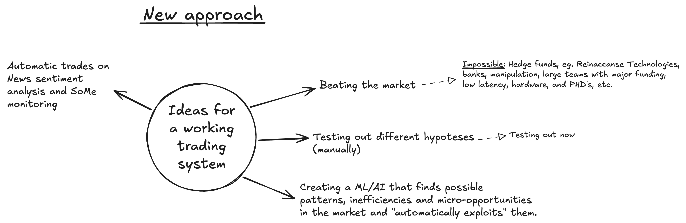

# ml-pred 🚀
The goal of this repository is to **explore possible ways to profit off the financial market**. In this current status of the repo, I'm **focusing on exploring different hypotheses** to find possible inefficiencies or micro-opportunities. Things that the "bigger institutions" might not prioritize because it is "so small" and not worth their time and resources.<br>
In previous tries, I've explored the challenge of "**beating the market**". However, after many months, being a beginner and much reading on the topic, this is **not feasible** for a lone (beginner) developer. There are far too many institutions, competition and manipulation in the market for _me_ to be able to pull that off. Hence, I've **narrowed down my goal** to not fight or beat _them_, but **understand them and use _my_ strengths**: Under the radar (physically, and in the market), agile (big corps can't change as quick as lone me), "fail fast"-mindset, and most importantly: "**Big firms have to deploy large amounts of capital efficiently. They ignore things that can’t scale to billions in value. This gives me space.**"

> [!NOTE]
> It's important know that this will probably not be the very best system, as I will also use this as a place to learn and take the time I need to really create and understand the different concepts of such a system myself.

## The hypothesis approach 🧑‍🚀
The approach of using different hypotheses to test and find possible inefficiencies is as follows:
1. **Data Processing**: Cleaning and Validating
2. **Data Engineering**: Creates features relevant for the hypothesis (e.g., volatility, returns, time of day). This will naturally not use Feature Selection.
3. **Data Labeling**: Create labels based on the inefficiency hypothesis. Eg:
    ```python
    # Label: Binary momentum success after 5 green candles?
    df['momentum_success'] = ((df['close'].shift(-5) - df['close']) > 0.0005)
    ```
4. **Machine Learning Model Training**: Train and evaluate ML models.

## Project Structure 🏗️
```
├── main.py                 # Main orchestrator for running complete trading pipeline
├── data/                   # Data engineering (historical & live data streaming)
├── model/                  # Model training and management
├── hypothesis/             # Hypothesis configurations and documentation
├── evaluation/             # Model evaluation and performance analysis
├── strategy/               # Complete trading strategy execution system ✨
├── broker/                 # Broker integrations for live trading
├── storage/                # Data, models, results, and performance storage
├── tests/                  # Comprehensive testing suite
├── config/                 # System configuration files
├── utils/                  # Shared utilities and helper functions
├── secrets/                # Sensitive credentials (not in repo)
├── images/                 # Documentation assets
├── trash/                  # Deprecated code
├── README.md               # Project overview
└── pytest.ini             # Testing configuration
```

> [!NOTE]
> The system is now a **complete end-to-end trading platform** capable of running strategies in both simulation and live trading modes. The strategy/ component ties together all other components to provide a fully functional trading system.

## Setup repo 🛠️
If this is the first time using the repo, follow these instructions:
1. Clone the environment (eg.): ``` git clone git@github.com:DanielWestgaard/ml-pred.git ```
2. Create a virtual environment (in root of project): ``` python3.11 -m venv venv ```
    - Recommended Python version: 3.11
    - Make sure to activate it: ```source venv/bin/activate```
3. Install dependencies: ``` pip install -r requirements.txt ```
4. Create secrets path: ``` mkdir secrets; cd secrets; touch secrets.txt; cd .. ```. Then, fill in the following (based on what you will use in the repo):
    - **For using Capital.com's [API](https://open-api.capital.com/)**: 
        1. Make sure you're following these [getting started steps](https://open-api.capital.com/#section/Getting-started).
        2. Paste in these variables in the secrets-file:
            ```
            API_KEY_CAP=
            PASSWORD_CAP=
            EMAIL=
            ```
        3. Fill in the values with from your own properties.
    - **For using [Alpha Vantage API](https://www.alphavantage.co/documentation/)**:
        1. Create your own [API token](https://www.alphavantage.co/support/#api-key).
        2. Paste in this variable in the secrets-file: ```alpha_vantage_free_api_key=```.
        3. Fill in your own API token for its value.
### Recommended, but not needed
- If you're using VSCode, I highly recommend installing these extensions:
    - [Excalidraw](https://marketplace.visualstudio.com/items?itemName=pomdtr.excalidraw-editor): an open-source virtual whiteboard tool designed for collaborative, freehand drawing and diagramming. This extension allows you to create and draw in VSCode, and view much more easily. Extension ID: pomdtr.excalidraw-editor
    - [Rainbow CSV](https://marketplace.visualstudio.com/items/?itemName=mechatroner.rainbow-csv): Prettier view of .csv-files.
    - [Material Icon Theme](https://marketplace.visualstudio.com/items/?itemName=PKief.material-icon-theme): Helps massively when you have many folders (icon some names).
- `gitstats` cmd-line tool (already in `requirements.txt`): Simple and easy tool to get statistics about your repository. Eg: `gitstats /Users/dmartinsen/pers-prog/ml-pred /Users/dmartinsen/pers-prog/ml-pred`

## Running ```main.py``` 👨‍✈️
```main.py``` is the main orchestrator of this whole project. If you want to run entire componentes, or test out smaller stuff, this is where you do it from.<br>
Make sure you've activated your venv, before running ```python main.py```.<br>
All other components will have an argument you can run ```main``` with. Eg. ```python main.py --fetch-data-capcom```.
### Current Functionality ⚡
> [!NOTE] 
> For a more thorough explanation of each component, see the README files in their respective folders.

**Complete Trading System:**
The provided path to hypothesis file is just an example.
- **Strategy Execution**: Full live trading and simulation capabilities
  ```bash
  python main.py -strat "hypothesis/1_session_based_tod_anomalies/config.yml"
  ```
  or 
  ```bash
  python main.py -hyp 'hypothesis/1_session_based_tod_anomalies/config_fixed.yml'
  ```

**Data & Model Pipeline:**
- **Hypothesis-Driven Data Pipeline**: Process data with specific market hypotheses
  ```bash
  python main.py -hyp "hypothesis/1_session_based_tod_anomalies/config.yml"
  ```
- **Historical Data Fetching**: Capital.com integration for market data
- **Live Data Streaming**: Real-time market data via WebSocket and REST APIs
- **Model Training & Evaluation**: Complete ML model lifecycle management

**Integration & Testing:**
- **Broker Integration**: Capital.com API integration with order management
- **Risk Management**: Multi-layer risk controls and position management
- **Performance Tracking**: Strategy results and trade performance monitoring

## Nice to know 💡
Trying to follow best practice for python, I have...
- Added readme's to each (important) folder to more granular descriptions and information about the different systems, and also trying to update them with a ```Structure``` paragraph for easier overview short descriptions.
- Using methods with prefix ```_``` before the method name to indicate a "private" method (/helper function). Eg. ```_plot_fs_analysis_cfs()```.
- I've chosen not to use ```__init.py__``` (in each directory), as modern Python (3.3+) no longer strictly required it for a directory to be recognized as a package. This might change in the future, depending on what libraries/packages I need (and if they require it).

# Descriptions for AI Assistants